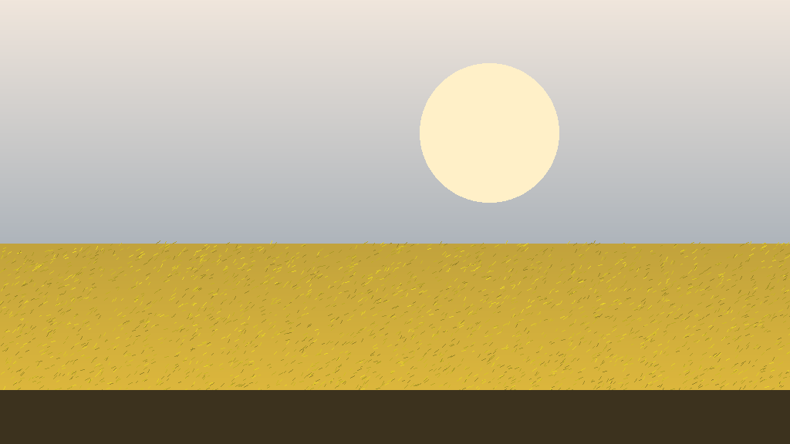

# firerender



A 3D engine and sandbox game in **pure C**: SDL3 (window, input, audio) +
OpenGL. The architecture is hybrid: a scene tree and render passes in the
spirit of Godot, a console, cvars and binds in the spirit of GoldSrc/Source,
resource resolution and missing files handled the way the Source Engine does
it. All GPU code goes through the engine's own RHI (`sr_*`, `src/srender.h`),
so swapping the graphics API never touches render logic.

**This project is written by neural networks** — Claude, DeepSeek, GLM and
other models working in a pair with a human: code, sanitizer debugging,
documentation and the agent working rules ([AGENTS.md](AGENTS.md)) are a joint
effort of people and LLMs.

> Repository: <https://github.com/nazar-ponomarenko-dots/firerender>
> License: **MIT** ([LICENSE](LICENSE)).

Open-world terrain: heightmap from a PNG height map, a procedural wheat and
grass field, billboard objects, water (puddles/lakes/rivers/sea), a sky with a
panorama and procedural clouds, cascaded shadow maps, screen-space GI and SSR,
voxel volumetric fog, particles/decals/weather, per-map Lua scripts.

---

## Quick start

```sh
make            # builds ./build/firerender AND re-bakes light for all maps
make run
```

> ⚠️ **`make` bakes every map by default** (`BAKE ?= 1`,
> `Makefile:208-211`; the `build/.baked.stamp` stamp protects from re-baking,
> but after any shader/map change this is minutes of work). For ordinary code
> iteration:
>
> ```sh
> make BAKE=0        # engine only
> make build/firerender
> ```

Requirements: `gcc` (or `clang`), SDL3 **3.x** for `pkg-config`, `python3` for
map packing. OpenGL functions are loaded at runtime via
`SDL_GL_GetProcAddress`, so there is no need to link `-lGL`/GLEW/EGL — SDL
itself picks GLX/EGL/WGL/CGL. Lua 5.4 and miniz are vendored in
`third_party/`, so the build depends on no system libraries.

```sh
make BAKE=0 && ./build/firerender            # run
FR_CONSOLE=1 ./build/firerender              # start with the console open
```

The data the engine uses lives **in the same folders as the sources**: nothing
is embedded, resources are looked up on disk or in a map's zip pak (see
“Maps”).

---

## Features

| Area | What is there |
|---|---|
| Rendering | CSM shadows (including a static/baked shadow mode and “blobs”), screen-space GI with temporal accumulation, SSR with a wetness mask, volumetric fog (3 R8 3D cascades) with history accumulation, bloom + tonemapping, procedural clouds, four water types with static reflection cubemaps |
| Scatter light | Forward+ clusters: directional/point/spot/rect/tube emitters, a light that follows the player |
| Baked light | Offline lightmap, sunvis and probe baking (`make mapbake`); runtime only reads (`r_baked_light`) |
| Vegetation | GPU-driven path: compute-cull (`shaders/veg_cull.cs`) + `glDrawElementsIndirect`; instanced CPU fallback for GLES/older drivers |
| World | Surface splat masks (soil/sand/gravel/asphalt), roads with shoulders and ruts, manual territory painting, triggers, positional sounds, fauna (fireflies/butterflies/birds) |
| Models | `.obj` and `.glb` (static, skinning, skeletal animations, clips), attaching files to a bone, sprites |
| Physics | Verlet mini-world: ropes, ragdolls on animated models |
| Player | Walk/run/crouch/jump/fly, HP with death and killcam, position saves |
| UI | Immediate-mode menu (UTF-8 Russian, TTF atlas), console with history and autocompletion, HUD, minimap, debug panel, profiler |
| Input | Keyboard/mouse, gamepad, touch (joystick + buttons), Android lifecycle |
| Scripting | Lua 5.4 in a sandbox: commands, events, entities, materials, FX |
| Performance | Dynamic resolution, low-end profiles, “PO-TATO/MEDIUM/ULTRA” presets, chunk regeneration budget, grass z-prepass |

Full references: [cvars](docs/cvars.md) ·
[commands](docs/commands.md) · [map.json](docs/map-json.md) ·
[Lua API](docs/lua-api.md).

For reading and working on the code: [architecture](docs/architecture.md) ·
[headless testing](docs/testing.md) ·
[code conventions](docs/conventions.md) ·
[traps and limitations](docs/pitfalls.md) ·
[AGENTS.md](AGENTS.md) — rules for AI agents.

---

## Controls

Default bindings (`src/binds.c:14-36`, restored with `bind_reset`):

| Key | Action |
|---|---|
| `W` `A` `S` `D` | movement |
| `SPACE` | jump / up in flight |
| `LCTRL` | down in flight |
| `LSHIFT` | run |
| `C` | crouch |
| `E` | interact with an object |
| `F` | `noclip` (fly through the world) |
| `[` / `P` | shadows / fog toggle |
| `G` / `H` | minimap / debug panel |
| `Q` | demo fly |
| `M` `,` `.` | sparks / smoke / blood at the look point |
| `F5` / `F9` | save / load |
| `F12` | screenshot into `screenshots/` |
| `` ` `` (tilde) | console |
| ESC | pause / back |

Everything is rebindable from the console: `bind B +jump`, `bindlist`,
`unbindall`. Gamepad and touch controls activate automatically
(`r_touch_ui`, `src/touch.c`, `src/gamepad.c`).

## Console

```
fov 90                      // cvars are just "name value"
bind F "+jump; +speed"      // a semicolon inside quotes is one body
alias turbo "sv_timescale 2; fov 100"
exec autoexec.cfg
wait 3; screenshot          // defer the rest by 3 frames
map map1                    // change the map
weather rain 150            // weather following the player
```

`help` — command list, `cvarlist` — variable list, `toggle <cvar>` — flip 0/1.
Changed `CVAR_ARCHIVE` variables, binds and aliases are written to
`config.cfg` on exit. Details — [docs/commands.md](docs/commands.md).

---

## Maps

A map is a resource folder and `map/map.json`. The shipping format is a zip
pak `maps/<name>.zip` (data only, the engine code is untouched):

```sh
make mapzip MAP=map1        # re-pack the map from the map/ dev folder
make mapbake MAP=map1       # bake light (the map as selected in config) + re-pack
make bake-maps              # bake light for ALL maps/*.zip (each with its own FR_MAP)
FR_MAP=map1 …               # force the map choice for the engine (src/game.c:722-725)
```

Resolution of any path (`src/resources.c:85-164`):

**open map pak → file in CWD → `<base_dir>/path` → `<base_dir>/../path`
→ `../path`**. A missing image is replaced with `img/notfound.png` with a
single log line — editing content does not require a restart.

Inside the map folder (or inside the zip) live its own `map.json`, `map.png`,
`img/`, `audio/`, `shaders/`, `baked/`, `lua/maps/<name>.lua` — all of them
override the engine resources. For development it is convenient to keep an
unpacked map in `map/` next to the binary.

The `map.json` structure is described in [docs/map-json.md](docs/map-json.md).

---

## Architecture

**Application phases** (`src/app.h:13-31`): `APP_BOOT` → `APP_MENU` →
`APP_PLAY` ⇄ `APP_PAUSE`. `boot_init` (`src/main.c:209-224`) brings up
resources → console → audio → binds → FX → command registry → HUD → menu →
`config.cfg` → Lua, and only then starts the loop.

**The loop** (`src/main.c`): rendering at free frequency, logic and physics on
a fixed 100 Hz step (60 Hz on Android to spare the CPU), with an accumulator
and a cap of 8 ticks per frame. Inside a tick: `game_update` → Verlet physics
→ ragdolls → audio → `engine.update`.

**World loading is 4 phases with per-phase rollback** (`src/game.c:325-645`):
1) world geometry (pak, `map.json`, heights/normals, field);
2) scene (node tree, entities, render FBOs, first frame);
3) applying the map (its `cvars` and `commands`);
4) audio (music, ambient, positional sources).
A failure at any phase rolls back what was already done instead of leaving a
half-loaded world; unloading runs in reverse order.

**A frame** (`src/renderer.c:881-1035`, state lives in one `RendererContext`,
`src/render_ctx.h`):

```
shadows (CSM, one pass for all cascades)
  → scene into FBO: terrain, water, objects, grass/wheat, sky, particles, decals
  → resolve (MSAA) → GI (screen-space, temporal)
  → SSR → volumetric fog (3D cascades)
  → bloom + tonemapping + underwater grade → present
  → HUD/console/menu (2D on top)
```

Objects are drawn through `SceneNode` trees with their own render functions;
every node has a shadow pass where it makes sense.

---

## Platforms and backends

| Backend | Status |
|---|---|
| OpenGL (desktop, 4.5 CORE) | **works** — `make` |
| OpenGL ES 3.0–3.2 | **works** — `make gles` (Android, Raspberry Pi); GPU-driven grass switches off by capability |
| Vulkan | groundwork: a device is brought up (`src/srender_vk.c`), the render pipeline is not ported — `make vulkan` |
| Metal | skeleton (`src/srender_metal.c`, builds only on macOS) — `make metal` |
| Web / Emscripten | **none** |

| Platform | How to build |
|---|---|
| Linux | `make` (or `make linux` — a static portable binary via zig + glibc 2.28) |
| Windows | `make win` / `make winpkg` (mingw; the data must be **next to the exe**, nothing is embedded in the exe) |
| Android | `make apk` (SDK + NDK r28+; resources as assets, GLES path) |
| macOS | SDL3 + `make` (CGL under the hood) |

`make backends` prints this status from the Makefile; at runtime — the
`Render API: …` line in the startup log.

---

## Testing and benchmarking (headless)

The engine can run without a display. Real headless rendering uses the
`offscreen` driver (it creates a GL context without X/Wayland); `dummy` only
checks “did the binary start”:

```sh
SDL_VIDEODRIVER=offscreen FR_TEST=S ./build/firerender    # screenshot at frame 450, then exit
SDL_VIDEODRIVER=offscreen FR_TEST=SlS ./build/firerender  # + .glb and a skeletal-animated model
SDL_VIDEODRIVER=offscreen FR_TEST=Sx ./build/firerender   # + console self-check
SDL_VIDEODRIVER=offscreen FR_BENCH=1 FR_BENCH_PRESET=2 ./build/firerender  # fps/p50/p95/p99
SDL_VIDEODRIVER=dummy timeout 5 ./build/firerender || true # CI-style smoke (see the caveat below)
```

> ⚠️ `dummy` does **not** create a GL window: `SDL_CreateWindow failed …
> driver (dummy)`, `exit 1`. That is exactly why this step in CI runs with
> `|| true` and only covers the path up to `SDL_CreateWindow`, not rendering.

The `FR_TEST` letters add up: `x` console, `S` screenshot+exit, `D` demo fly,
`g`/`l` glb and animated model, `R` rope, `H` ragdoll, `K` killcam,
`a`/`n`/`y` rain/snow/explosion, `s`/`o`/`v`/`p`/`q`/`c`/`e`/`f`/`t`/`k`/`r`/`C`/`w`
— subsystem switches off for A/B frames. Other variables: `FR_MAP`, `FR_POS`
(teleport for shots), `FR_W`/`FR_H`, `FR_MSAA`, `FR_BAKE`, `FR_CONSOLE`.
Sanitizers (as in CI — build from scratch, otherwise the target is already
“fresh”): `make clean && make BAKE=0 EXTRA_CFLAGS="-fsanitize=address,undefined -O1 -g"`.
The full harness, every `FR_TEST` letter and A/B recipes —
[docs/testing.md](docs/testing.md).

---

## Project structure

```
src/            ~70 modules of pure C (core, render, scene, world, UI, scripts)
shaders/        GLSL: single sources, `#version` substituted for GLES or
                desktop (`src/shader.c`), hot-reload by mtime
map/            dev version of a map: map.json, map.png, img/, baked/, shaders/
maps/           shipping paks: map1.zip
img/ audio/     engine textures and sounds
lua/            main.lua (engine script) and maps/<map>.lua
models/         test .glb/.obj models (in .gitignore)
cubemaps/       captured water reflection faces (cubemap_capture)
tools/          make_map_zip.py, inject_baked.py, make_apk.sh, texture generators
third_party/    SDL3 (optional), Lua 5.4, miniz, stb
docs/           references (cvars, commands, map.json, Lua API) and developer
                docs (architecture, testing, conventions, pitfalls)
AGENTS.md       working rules for AI agents
```

`buildnum.txt` is a local counter: every `make` increments it and writes
`src/buildnum.h`; the number is visible in `version`
(`firerender 0.4 build #N`).

## License

**MIT** — full text in [LICENSE](LICENSE). The code and engine assets of this
repository are free: you may use, modify and distribute them provided the
copyright notice is kept.

Vendored third-party libraries keep their own licenses: Lua 5.4 (MIT),
miniz (MIT), `stb_truetype.h` / `font8x8_basic.h` (public domain / MIT).
